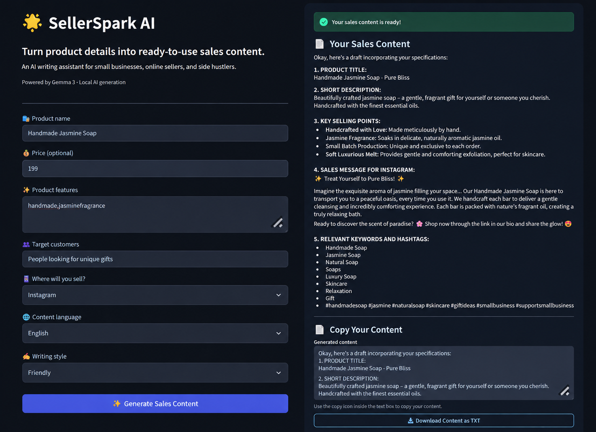

# 🌟 SellerSpark AI

**Turn product details into ready-to-use sales content.**

SellerSpark AI is a local AI-powered marketing assistant for small businesses, online sellers, and side hustlers.

## 📸 Application Demo



## ✨ Features

- Generate product titles and short descriptions
- Create key selling points and sales messages
- Generate content for Instagram, WhatsApp, and online marketplaces
- Choose English or Telugu
- Select a writing style
- Copy generated content
- Download marketing content as a TXT file
- Run AI generation locally using Gemma 3 and Ollama

## 🛠️ Tech Stack

- Python
- Streamlit
- Ollama
- Gemma 3 (1B)

## 🚀 Getting Started

### 1. Install Python dependencies

```bash
pip install -r requirements.txt
```

### 2. Install Ollama

Install Ollama from https://ollama.com/

### 3. Download the model

```bash
ollama pull gemma3:1b
```

### 4. Run the application

```bash
python -m streamlit run app.py
```

Open the local URL displayed in your terminal.

## 🔒 Why Local AI?

SellerSpark AI uses a locally running model through Ollama. Product information sent to the model is processed locally when the application is configured to use the local Ollama instance.

## ⚠️ Important

AI-generated marketing content can contain incorrect or unsupported claims. Review all content before publishing it.

## 🎯 Who Is It For?

- Small-business owners
- Handmade-product sellers
- Student entrepreneurs
- Online resellers
- Side hustlers

## 🌱 Open Source

SellerSpark AI is being developed as an experiment in making AI-assisted marketing tools more accessible to small businesses.

## 📄 License

MIT License
